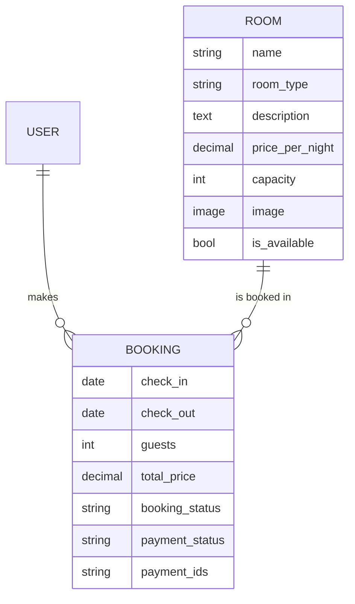

<div align="center">

<p>


</p>

<p>
<a href="#features"></a>
<a href="#how-a-booking-works"></a>
<a href="#quick-start"></a>
<a href="#data-model"></a>
<a href="#production-checklist"></a>
<a href="#author"></a>
</p>
</div>

## About
 
**Blue Haven** is a learning project that covers the full hotel-booking journey: room browsing, user accounts, validated booking forms, booking history, an admin panel, and optional **Razorpay** test-mode payments. Without Razorpay keys it falls back to a clearly labelled local demo flow, so you can try everything without charging a rupee.
 
## Features
 

## How a booking works
 

## Tech stack
 
| Layer | Technology |
| --- | --- |
| Backend | Python 3.10+, Django |
| Frontend | HTML templates, Bootstrap 5 (CDN) |
| Database | SQLite |
| Payments | Razorpay Checkout (test mode) with local demo fallback |
| Admin | Django Admin |
 
## Quick start
 
> **Requirements:** Python 3.10+, pip, and internet access for the Bootstrap CDN and (optionally) Razorpay Checkout.
 
```bash
python -m venv venv
venv\Scripts\activate          # macOS/Linux: source venv/bin/activate
pip install -r requirements.txt
python manage.py makemigrations hotelapp
python manage.py migrate
python manage.py createsuperuser
python manage.py runserver
```
 
Then open:
 
| Page | URL |
| --- | --- |
| Website | http://127.0.0.1:8000/ |
| Rooms | http://127.0.0.1:8000/rooms/ |
| Admin | http://127.0.0.1:8000/admin/ |
 
> Add room records in Django Admin first, otherwise the public site will show no rooms.
 
<details>
<summary><b>Add a sample room</b></summary>
<br/>
| Field | Value |
| --- | --- |
| Name | Deluxe Room |
| Room type | Deluxe |
| Description | Comfortable room with a king-size bed and Wi-Fi. |
| Price per night | 2500 |
| Capacity | 2 |
| Is available | enabled |
| Image | optional |
 
</details>
<details>
<summary><b>Optional: Razorpay test mode</b></summary>
<br/>
Without keys, the project uses a local demo flow that does not charge money.
 
PowerShell example with test credentials:
 
```powershell
$env:RAZORPAY_KEY_ID="rzp_test_your_key_id"
$env:RAZORPAY_KEY_SECRET="your_test_secret"
python manage.py runserver
```
 
> Never commit secrets to GitHub. Do not use demo-payment mode in production.
 
</details>
<details>
<summary><b>Useful commands</b></summary>
<br/>
```bash
python manage.py check
python manage.py makemigrations
python manage.py migrate
python manage.py createsuperuser
python manage.py runserver
python manage.py test
```
 
</details>
## Data model
 

 
- **Room** - name, type, description, nightly price, capacity, image, availability.
- **Booking** - user, room, dates, guests, total price, booking/payment status, payment IDs.
## Project structure
 
```text
Blue-Haven-Hotel-Booking-System/
|-- templates/            # HTML templates
|-- models.py             # Room, Booking
|-- forms.py              # booking / room / review forms
|-- views.py              # page and booking logic
|-- urls.py               # routes
|-- admin.py              # Django Admin setup
|-- apps.py
|-- hotel_detail.html     # hotel detail page
|-- room_detail.html      # room detail page
|-- room_form.html        # room form
|-- hotel_form.html       # hotel form
|-- review_form.html      # review form
|-- WORKING_DEMO.html     # static demo
|-- requirements.txt
`-- README.md
```
 
## Production checklist
 
This is an educational starter project, not a production-certified booking platform. Before going live:
 
- [ ] Set `DEBUG=False`, a strong `DJANGO_SECRET_KEY`, and valid `ALLOWED_HOSTS`
- [ ] Use HTTPS and secure cookie settings
- [ ] Keep API secrets out of source control
- [ ] Add payment webhooks, idempotency, reconciliation, and refund workflows
- [ ] Add transaction/locking protection against simultaneous overlapping bookings
- [ ] Add logging, backups, monitoring, notifications, and more tests
- [ ] Configure production static/media storage; review privacy and accessibility
## Troubleshooting
 
| Problem | Fix |
| --- | --- |
| `No module named django` | Activate the venv and run `pip install -r requirements.txt` |
| Rooms not showing | Add room records at `/admin/` |
| CSS missing | Check `static/css/style.css` |
| Migration issue | `python manage.py makemigrations hotelapp` then `python manage.py migrate` |
| Razorpay issue | Verify both test credentials and internet access |
 
## Author
 
**Deepak Bharti** - Django / Laravel developer
 
[](https://www.linkedin.com/in/deepak-bharti-ab7622315)
[](https://github.com/deepakbharti-cloud)
[](https://deepakbharti.github.io)
 
<br/>

